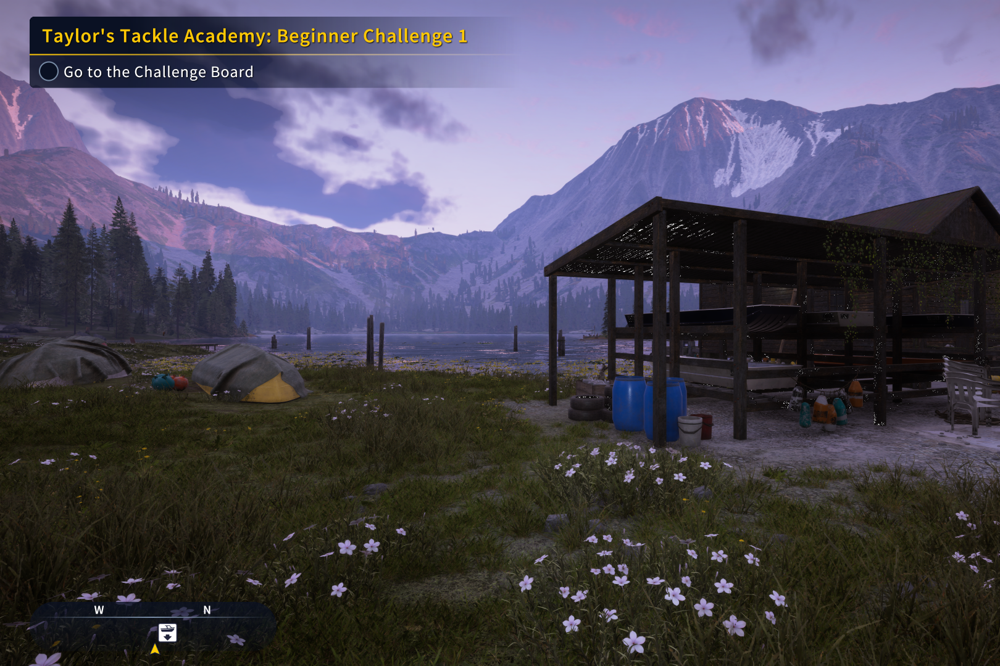

# Call of the Wild: The Angler Crash Fix

**Call of the Wild: The Angler crash fix** for PC (Steam, DirectX 12). It stops the random
**"We're sorry, something went wrong"** crash (Apex Crash Handler, crash to desktop) that happens
mid-game, even while idle. It's a community fix: it changes 5 bytes of the game exe, backs up the
original first, and can be undone with one command.

Keywords: The Angler crashing, The Angler crash to desktop, COTW The Angler crash fix, Apex Crash
Handler something went wrong, The Angler access violation, CotWTheAngler_Steam.exe crash.



*In-world in Golden Ridge Reserve with the fix applied, during the 77-minute crash-free test.*

## Symptoms this fixes

- The game closes and the Apex Crash Handler window says "We're sorry, something went wrong :(".
- It happens at random, after minutes or hours of play, even while standing still (AFK).
- Reinstalling, verifying files and updating GPU drivers don't help.
- The crash dump shows an access violation inside `CotWTheAngler_Steam.exe` itself, at one of
  `+0x104A725`, `+0x104A832`, `+0x104ACDF` or `+0x1049F7C`.

## What causes it

The game records its rendering commands on several worker threads. When a render pass needs a
graphics pipeline (a compiled shader) that isn't ready yet, its thread waits for the compile. While it
waits, the game's job system lets that **same thread run other queued jobs**. One of those jobs can
change or reset the command list that the waiting pass is still recording. When the pass resumes, the
command list's root-signature pointer is null (or its upload page is closed), and the game crashes.

Because it is a timing race, crash frequency varies a lot by PC. More CPU threads, background load,
high resolution and a freshly cleared shader cache (for example after a driver update) all mean more
shader waits and more chances to hit it.

## What the fix does

One instruction in the pipeline-wait loop (RVA `0x1062F7F`) is changed:

| | Bytes | Meaning |
|---|---|---|
| Original | `E8 5C F2 EA FF` | call the job pump (run another job inline while waiting) |
| Fixed | `31 C0 0F 1F 00` | report "no job run", so the loop falls through to its existing `SwitchToThread` yield |

The thread still waits for its pipeline. The pipeline still compiles on the game's other worker
threads. The wait just no longer runs unrelated work in the middle of an unfinished render pass.

## Easy install (no technical knowledge needed)

1. Close the game.
2. Download **`AnglerCrashFix.zip`** from the
   [latest release](https://github.com/finalpantasy/call-of-the-wild-the-angler-crash-fix/releases/latest).
3. Right-click the zip and choose **Extract All**.
4. Double-click **`Install Angler Crash Fix.bat`**, then wait for "Done: crash fix applied."

If Windows shows "Windows protected your PC", click **More info**, then **Run anyway**. If it says
access is denied, right-click the file and choose **Run as administrator**.

**To uninstall,** double-click **`Uninstall Angler Crash Fix.bat`**, or in Steam right-click the game >
Properties > Installed Files > **Verify integrity of game files**.

The installer saves a copy of the original game file as `CotWTheAngler_Steam.exe.stock-backup` in the
game folder before changing anything.

## Install from the command line

1. Close the game.
2. Download `AnglerCrashFix.ps1`.
3. In the folder you downloaded it to, run:

```powershell
powershell -ExecutionPolicy Bypass -File .\AnglerCrashFix.ps1 -Apply
```

The script finds the game through your Steam libraries. If it can't, add
`-GamePath "D:\path\to\Call of the Wild The Angler"`.

Example output:

```
Game exe : E:\SteamLibrary\steamapps\common\Call of the Wild The Angler\CotWTheAngler_Steam.exe
SHA-256  : F3042F580F7EF79349313388522249EB906D91266D760893B7BF1A0BDE169021
State    : original (not patched)
Backup   : E:\SteamLibrary\steamapps\common\Call of the Wild The Angler\CotWTheAngler_Steam.exe.stock-backup
Done: crash fix applied.
```

Check the state at any time with `.\AnglerCrashFix.ps1` (no options).

## Uninstall

```powershell
powershell -ExecutionPolicy Bypass -File .\AnglerCrashFix.ps1 -Revert
```

Steam's **Verify integrity of game files** also restores the original exe.

## Safety

- **Supported build only.** The script patches only the exact Steam exe it was made for
  (Steam build 16541670, SHA-256 `F3042F58…69021`). On any other version it refuses and changes
  nothing.
- **Backup first.** It copies the original exe to `CotWTheAngler_Steam.exe.stock-backup`, and checks
  the backup's hash before patching.
- **Self-checking.** After writing, it checks that the result is the expected patched file, and puts
  the original bytes back if not.
- **Nothing else is touched.** It changes no saves, settings or other game files, and runs no
  background process.
- The game ships no anti-cheat, so a patched exe doesn't trigger a ban system.

## Test results

Tested on Windows 11, RTX 4090 (driver 617.42), offline mode, Golden Ridge Reserve.

| | Unpatched | Patched |
|---|---|---|
| Crashes | 5 in about 48 min of play (about 1 per 10 min) | 0 in about 127 min over two launches (38 min idle + 89 min walking into new areas) |

At the unpatched rate, 127 crash-free minutes would happen by chance about 3 times in a million.

Not yet tested: online or co-op sessions, and long active fishing sessions. Reports welcome.

## Possible side effect

If every worker thread waited on a pipeline at once, nothing would be left to compile it, and the
game would **freeze** instead of crashing. No freeze happened in testing. If you see a hard freeze,
revert and open an issue.

## Notes

- A Steam update replaces the exe. The script will then report an unknown build, and the fix needs a
  new version for that build.
- This project ships no game files. The script patches your own installed copy.
- Not affiliated with or endorsed by Expansive Worlds or THQ Nordic.

## License

MIT
